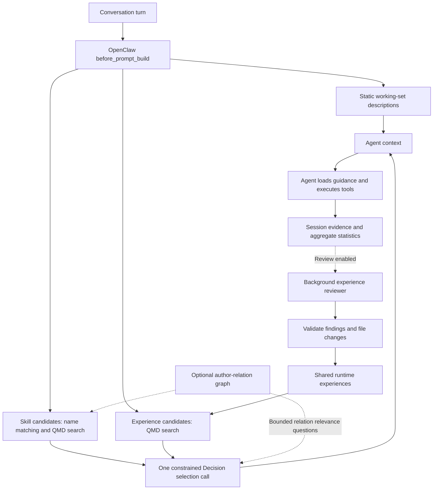

# Skill Harness

[](https://github.com/openclaw/openclaw)
[](https://opensource.org/licenses/MIT)

Skill Harness is an OpenClaw plugin that helps agents find relevant skills and reuse experience from previous work. Before an agent replies, it searches skills and experiences, selects the relevant candidates, and adds compact guidance to the conversation. An optional reviewer turns evidence from completed turns into reusable experience for future tasks.

The project combines **skill discovery**, **experience retrieval**, and **experience curation** around existing OpenClaw agents. Skills remain ordinary skill files; experience lives separately in runtime storage.

## Why this project exists

As a skill library grows, listing every skill in every prompt consumes context and makes it harder to find the right workflow. Short descriptions also leave out details that matter for selection: applicability, prerequisites, operating steps, and failure conditions often appear only in the full skill document.

Repeated work introduces another problem. An agent may solve the same issue again without retaining the useful procedure, while indiscriminate memory capture accumulates duplicate or outdated advice.

Skill Harness addresses these problems with:

- **On-demand discovery:** search skill metadata, bodies, and reference files before selecting a bounded set for the current task.
- **Reusable experience:** retrieve past procedures independently of skill discovery, including standalone guidance without skill associations.
- **Progressive loading:** inject descriptions and experience summaries; let the agent load detailed instructions when relevant.
- **Evidence-based curation:** optionally review completed turns, check existing coverage, and create, refine, merge, or delete experience when the evidence supports a change.

For example, a request to diagnose a deployment can surface a relevant operations skill alongside an experience describing a previously verified diagnostic sequence. The agent loads the skill through `skill_view`, queries further experience through `skill_experience`, and applies the guidance to the current environment.

## Research context

These papers provide context for the design choices and related directions. The table distinguishes the research ideas from the behavior implemented here; the papers' benchmark results are not measurements of this plugin.

| Paper                                                                                                                          | Research idea                                                                                                     | Relationship to Skill Harness                                                                                                                                                                |
| ------------------------------------------------------------------------------------------------------------------------------ | ----------------------------------------------------------------------------------------------------------------- | -------------------------------------------------------------------------------------------------------------------------------------------------------------------------------------------- |
| [SkillRouter: Skill Routing for LLM Agents at Scale](https://arxiv.org/abs/2603.22455)                                         | Skill bodies contain routing evidence that names and descriptions can miss; retrieve candidates before reranking. | Searches metadata, bodies, and references, then uses one constrained Decision selection call. Uses QMD and Jev rather than SkillRouter's trained retrieval/reranking models.                 |
| [SkillDAG: Self-Evolving Typed Skill Graphs for LLM Skill Selection at Scale](https://arxiv.org/abs/2606.03056)                | Typed directed relations add structure to skill selection, and execution can inform graph evolution.              | Offers an imported author-relation graph and optional bounded candidate expansion. Relations remain unverified hints; runtime review curates experiences rather than evolving graph edges.   |
| [Compositional Skill Routing for LLM Agents: Decompose, Retrieve, and Compose (SkillWeaver)](https://arxiv.org/abs/2606.18051) | Complex tasks can require decomposition, retrieval, and dependency-aware composition of multiple skills.          | Selects multiple relevant skills; task decomposition and executable DAG planning remain related work, outside the current routing pipeline.                                                  |
| [SkillOpt: Executive Strategy for Self-Evolving Agent Skills](https://arxiv.org/abs/2605.23904)                                | Bounded document edits can improve an agent's external state when accepted through validation.                    | Reviewer changes pass schema, content, operation, and concurrency checks. This is experience curation; it does not optimize skill files using scored rollouts or held-out performance tests. |

## Architecture



| Component           | Role                                                                                                                 |
| ------------------- | -------------------------------------------------------------------------------------------------------------------- |
| Skill catalog       | Resolves the invoking agent's visible skills and provides discovery/loading tools.                                   |
| QMD indexes         | Hybrid retrieval over skill metadata, bodies and references, and experience keywords, summaries and bodies.          |
| Decision selector   | Evaluates the combined candidate pool against the conversation and configured relevance thresholds.                  |
| Prompt integration  | Adds a static working set and compact, advisory dynamic context through OpenClaw hooks.                              |
| Experience reviewer | Optionally examines completed turns and proposes validated experience changes.                                       |
| Runtime state       | Stores experiences, session evidence, review outcomes, managed indexes, and aggregate telemetry outside the package. |

### Before a reply

1. Add skill-discovery guidance and the configured static working-set descriptions. Automatic workspace/workshop additions can be controlled separately.
2. For eligible agents and chats, search skill and experience candidates in parallel using the conversation context. Skill discovery combines typo-aware name matching with QMD retrieval.
3. Build one deduplicated skill pool from name/QMD hits and visible skills associated with all retrieved experience candidates. Optional relation expansion starts only from the original name/QMD hits. If candidates exist, make at most one unified Decision evaluation that independently scores every skill, experience and bounded relation; an empty pool skips selection.
4. Inject only individually selected skills and experiences, subject to their separate configured limits. Selecting an experience does not automatically select its associated skills.
5. The agent uses `skill_view` to load skill instructions and `skill_experience` to search detailed experience before applying relevant guidance.

Dynamic context contains optional `<matched_skills>` and standalone `<matched_experiences>` blocks. Each selected experience summary appears once: inside its highest-scored final associated skill, or standalone if no associated skill survives selection. Skills are ordered by selector score with a locale-independent name tie-break (UTF-16 string order); experience score ties use the same ordering on IDs. Experiences with no associations, invisible associations or rejected associated skills remain eligible. Placement never boosts skill scores or requires loading a skill. The context is advisory, non-user input; full documents and the entire catalog are not inserted.

Runtime search or selection failures let the main agent continue with available static context. Failed selection does not inject an unchecked fallback list. Invalid configuration can still prevent the plugin from loading.

### After a completed turn

Review is disabled by default. When enabled, experience-health cadence, uncertain routing, or capability-fit evidence can schedule a background investigation. A trigger does not itself prove that an experience should be written.

The Review execution module loads only after Review is enabled and a trigger survives evaluation. After asynchronous loading and snapshot preparation, the plugin rechecks lifecycle cancellation, scheduler disposal, host hook validity, and the originating turn before queueing work. Pipeline events remain synchronous. QMD itself remains loaded on demand.

The reviewer checks existing coverage before creating an entry, prefers refining an existing procedure, and can merge overlapping experiences or remove guidance proven obsolete, useless, or superseded. A no-finding outcome is valid. Changes are checked against the declared operation, actual file changes, eligible observed skills, and concurrent updates before writeback.

Review operates on experience copies in a temporary workspace. Filesystem tools are workspace-restricted; `exec` follows the host execution policy and has no additional shell sandbox supplied by this plugin. Its prompt limits commands to experience maintenance. Review does not train model weights or authorize edits to skill sources.

## Installation and setup

Use OpenClaw **2026.10.7 or later**, Node.js **26.12.1 or later**, and the pnpm version declared in [`package.json`](package.json). QMD requires Node.js 26; development CI uses Node.js 26.

### 1. Build and install

```bash
git clone https://github.com/ani6439walc/openclaw-plugin-skill-harness.git
cd openclaw-plugin-skill-harness
pnpm install --frozen-lockfile
pnpm run build
openclaw plugins install --link .
```

The linked installation uses this checkout. Rebuild after changing source files. Direct `git:` installation is unsupported because the compiled `dist/` entry is not tracked and the Git installer does not perform this build.

### 2. Configure model services

Merge this entry into your existing `openclaw.json`:

```json5
{
  plugins: {
    entries: {
      "skill-harness": {
        enabled: false,
        hooks: { allowConversationAccess: true },
        config: {
          qmd: {
            embedding: { model: "bifrost/text-embedding-3-small" },
            expansion: { model: "bifrost/gpt-4o-mini" },
            jev: { model: "typesafe/jev-latest" },
          },
          decisionModel: { model: "typesafe/jev-latest" },
        },
      },
    },
  },
}
```

`qmd.embedding.model` and `qmd.expansion.model` are required. The two Jev endpoints are optional and independent: `qmd.jev` serves QMD search only; plugin `decisionModel` serves automatic candidate selection when no host Decision model is selected, and the existing manual relation importer. Each endpoint, when present, requires a nonempty `model`; `baseUrl` and `apiKey` are optional. The example's `bifrost` and `typesafe` providers must already exist in OpenClaw's provider configuration. `provider/model` resolves endpoints and credentials from the provider catalog; explicit fields, environment references, and supported SecretRef objects retain their existing resolution. `qmd.embedding.dimension` defaults to `1536`; set it to match your embedding model.

Automatic selection first checks the invoking agent's host `decisionModel` string, then `agents.defaults.decisionModel`, then the plugin's endpoint object above. An explicit empty or whitespace-only agent string suppresses the global default and permits the plugin route; an absent, null, or non-string agent value inherits a nonempty global string. A host-only setup may omit plugin `decisionModel`; a plugin-only setup needs no host Decision selection. Without either route, dynamic selection is skipped. Every host call carries the owning `agentId`, including when the model is inherited globally. Once the host route is selected, unavailable providers, timeouts, malformed answers, and errors skip dynamic context without trying the plugin endpoint or conversational model.

Skills, experiences, and relation questions share one full batch per eligible turn. Empty pools make no evaluation call; hook rebuilds reuse the same turn's in-flight or terminal result. Neither route retries, splits batches, nor trims candidates to fit a provider. Full-batch preflight rejects more than 256 questions, 1 MiB of JSON, 20,000 nodes, or depth 32; a provider's smaller limits may return `unsupported-input`, which skips selection. `routing.timeoutMs` defaults to 5,000 ms; host evaluation uses at most 30,000 ms. Host requests use the public Decision V1 API without model or thinking overrides. Turn deadlines and plugin shutdown cancel selection; static context remains available.

Managed skill and experience searches keep `rerank: false`; query expansion continues to use `qmd.expansion`. `qmd.jev` can supply QMD's search-strategy/HyDE assistance and native reranking configuration. Omitting it does **not** disable all QMD Jev behavior: the existing Jev expansion compatibility path and native `TYPESAFE_API_KEY`, `TYPESAFE_BASE_URL`, and `TYPESAFE_DEFAULT_MODEL` environment sources remain. Neither plugin nor host `decisionModel` is forwarded to QMD. Changing plugin `decisionModel` does not rotate QMD stores; changing `qmd.jev` drains active operations and reopens the same database without changing the embedding fingerprint.

#### Migrating the former root Jev setting

Back up your configuration privately before upgrading. Remove the old top-level plugin `jev` object: the strict manifest rejects it, and the runtime compatibility parser ignores it without an alias. To retain its QMD use, copy the endpoint explicitly to `qmd.jev`; to retain plugin selection or manual import, separately configure `decisionModel`. Neither new field inherits the other. A configured host Decision model now takes precedence over plugin selection. Validate the new shape in an isolated profile before applying it. Configuration rollback requires restoring both the prior plugin build and its prior configuration shape; preserve runtime sessions, experiences, graph, statistics, and Review state. A QMD downgrade additionally requires the matching offline index backup described below.

External plugins need `hooks.allowConversationAccess: true` to register conversation hooks, including automatic prompt routing and end-of-turn Review. Keep `hooks` beside `config`, not inside it. Prompt injection is allowed by default; an explicit `hooks.allowPromptInjection: false` disables the prompt hook even with conversation access. The plugin does not grant itself these permissions. See [OpenClaw hook permissions](https://docs.openclaw.ai/plugins/hooks#permissions-and-scope).

#### Shared document embedding cache and Voyage

The bundled QMD runtime uses remote models only. BM25, document reads, Chinese segmentation, AST chunking, CLI, and MCP remain available; local inference, model downloads, GPU initialization, local tokenization, and local model fallback are retired. Configure the required embedding and expansion fields above; QMD Jev is independent and optional. Missing remote configuration produces an explicit model-operation error without choosing a provider or uploading documents. Pure lexical QMD operations require no model. `qmd pull` now explains the retirement and exits nonzero.

Old local QMD configurations and indexes remain readable for lexical search and diagnostics. They are not automatically adopted into a remote embedding identity. To change embedding providers or models, configure a remote provider and follow the explicit whole-database rebuild procedure below; preserve the existing collection definitions and back up the index first. The separate vector layout conversion described below does not change embedding identity. Local inference SDK entry points are breaking changes; see QMD's remote-only compatibility notes.

The plugin pins the published `@wei840222/qmd` version `2026.10.25`; the lockfile records the registry artifact. Install with `pnpm install --frozen-lockfile` to reproduce that dependency. No Git checkout or unpublished QMD prerelease is required.

Before first starting this release against existing indexes, stop all Gateway generations and other processes using those indexes, then take a complete offline backup of `dataRoot/qmd/skills/` and `dataRoot/qmd/experiences/`, including any SQLite WAL/SHM files and the associated mappings, metadata, and leases. Copying a running WAL database file by file is not a consistent backup. Keep the backup outside the repository and package.

QMD 2026.10.25 converts the legacy vector table to collection partitions on the first writable open. Full registration owns that initialization, including reopening an unchanged experience catalog; discovery remains read-only and cannot convert an old index. The layout conversion copies usable vectors without calling a model or reembedding, but unsupported legacy tables and rows without active document/chunk metadata can be discarded; do not assume it is lossless. Allow time for conversion and its final VACUUM during startup. Do not run an older QMD build against an index being converted.

Restore the complete matching offline index backup before downgrading QMD. Restoring only the old plugin build or mixing an older main database with newer WAL/SHM files is insufficient; without the backup, returning to the older vector layout requires a full paid reembedding. This is separate from changing embedding models or dimensions, which retains its explicit rebuild requirement. A read-only process can use lexical retrieval on an unconverted legacy index, but vector retrieval requires full registration to complete the conversion first.

Set optional `qmd.embeddingCacheDir` to share document embeddings across skill and experience stores, agents, and processes that use the same directory. Without it, QMD uses its in-memory cache. The plugin forwards the directory unchanged after trimming whitespace; it does not append agent or generation names. QMD expands `~`; relative paths use the process working directory, **not** `dataRoot`. Prefer an absolute path on persistent disk, or tmpfs such as `/dev/shm` when RAM usage and loss on reboot are acceptable.

The QMD cache retains successful document embeddings for up to two hours, bounded to 2,000 entries / 64 MiB of payload (SQLite adds overhead). Identity, credentials, and exact formatted input must match. It does not persist query embeddings or expansion results. Cache misses sharing a directory serialize while the remote request runs; waiting respects the request timeout. Cache failure falls back to ordinary embedding, so this is not a permanent exactly-once guarantee. Changing the directory reopens stores after active operations drain without changing index fingerprints or rebuilding vectors. Read-only discovery does not create the disk cache.

Skill-index mapping publication, lifetime leases, and discovery reads share a FIFO catalog queue within each plugin instance. The existing one-second cross-process file-lock deadline starts only after local queue admission. Maintenance with a zero-wait budget skips a busy queue or lock immediately. Failed work releases the queue, and shutdown stops new work and drains accepted operations before stores close and leases release. Debug diagnostics report only operation category, acquisition outcome, and queue/lock/hold durations; they omit skill names, conversations, and credentials. Independent plugin instances still coordinate through the existing file lock and lease format.

For native Voyage, merge this complete model configuration into the plugin config, retaining your configured expansion and Jev providers:

```json5
{
  qmd: {
    embeddingCacheDir: "/dev/shm/skill-harness-qmd-embeddings",
    embedding: { model: "voyageai/voyage-4", dimension: 1024 },
    expansion: { model: "bifrost/gpt-4o-mini" },
    jev: { model: "typesafe/jev-latest" },
  },
  decisionModel: { model: "typesafe/jev-latest" },
}
```

`voyage/` and `voyageai/` resolve to the official endpoint and `VOYAGE_API_KEY` from the Gateway environment when explicit or configured provider values are absent. Set `dimension: 1024` explicitly: the plugin retains its existing `1536` default. QMD supplies Voyage's native `input_type` and `output_dimension` fields ([Voyage API reference](https://docs.voyageai.com/reference/embeddings-api)). A custom gateway must accept that native protocol; a provider prefix selects connection settings, not the HTTP protocol.

#### Upgrading existing Voyage indexes

QMD `2026.10.6` uses a native Voyage identity. Existing vectors produced by the older OpenAI-compatible provider are incompatible even when model, dimension, and endpoint are unchanged. Ordinary refresh does not authorize destructive rebuilding. Lexical search may still work, and plugin `ready` alone does not prove vector readiness.

Use a separately approved, one-time maintenance window:

1. Enumerate the distinct skill databases referenced by `dataRoot/qmd/skills/agents/` mappings under `dataRoot/qmd/skills/indexes/<fingerprint>/skill-search.sqlite`, plus `dataRoot/qmd/experiences/experience-routing.sqlite`. Inspect each database with the new resolved models and `readOnly: true`; check `getStatus().diagnostics.embedding.identity.compatible`. Confirm the exact affected databases and embedding request cost before rebuilding.
2. Stop **all** Gateway generations and other users of these databases. Back up the affected stores and managed metadata while quiescent. Preserve snapshots, mappings, leases, `gc.json`, and experience metadata; do not delete index directories or rewrite identity fields.
3. Open each affected database with the installed QMD SDK, its exact `dbPath`, and the complete `config: { collections, models }` using its existing managed collection definitions and the new resolved Voyage settings. Preserve collection contexts and global context if present. Supplying inline config reconciles the database collections: do not omit `collections` or replace them with an empty object. Call `await store.embed({ force: true })` once per database, with no collection restriction, and always close the store. This replaces its vectors, makes new API requests, and bypasses the document cache; do not add `force` to recurring refreshes.
4. Require zero embedding errors, `needsEmbedding === 0`, compatible identity and ready embedding build diagnostics, then verify `searchVector()` on known indexed content. Reopen read-only and recheck before restarting the Gateway. A subsequent ordinary `embed()` should process zero unchanged documents. If any database fails, keep maintenance paused and inspect diagnostics or restore the quiescent backup; do not resume with an assumed successful rebuild.
5. Restart with the new plugin and verify searches through each intended agent's actual Gateway tools. Check semantic diagnostics separately from lexical results. Local tests do not establish deployed readiness.

### 3. Choose the static working set

Before enabling, move any native static skill selections into the plugin's `skills.workingSet`, and move intentionally shared `skills.load.extraDirs` paths into `skills.sharedRoots`:

```json5
{
  skills: {
    workingSet: {
      defaults: ["safe-default"],
      agents: { main: ["agent-first"] },
    },
    sharedRoots: ["/absolute/path/to/shared-skills"],
    includeWorkspaceSkills: true,
    includeWorkshopSkills: true,
  },
}
```

This is a fragment inside `plugins.entries["skill-harness"].config`. Replace the example skill names and directory with your own, or omit these optional settings.

By default, startup empties native `agents.defaults.skills`, removes agent-specific native `skills` lists, and clears `skills.load.extraDirs` to avoid duplicate prompt inventories. `skills.suppressNativeSkillPrompt` and `skills.suppressNativeExtraDirs` independently disable these mutations when set to `false`; native lists are not an input to the plugin's working set.

Agent-specific working-set entries appear before shared defaults, followed by enabled workspace and workshop additions. Include flags affect automatic prompt additions; the agent can still discover or explicitly load visible skills through tools.

### 4. Enable and verify

```bash
openclaw plugins enable skill-harness
openclaw gateway restart
openclaw gateway status --deep --require-rpc
openclaw plugins inspect skill-harness --runtime --json
openclaw plugins doctor
```

`plugins inspect --runtime` loads the plugin in the inspecting CLI process and reports local registration, configuration, and blocked-hook diagnostics; it does not inspect the running Gateway's loaded instance. `gateway status --deep --require-rpc` checks Gateway availability. Verify the deployed build separately through the intended agent's actual `skill_list`, `skill_view`, and `skill_search` tools, then send an eligible direct-chat request and check Gateway logs and the resulting routing context. Indexes are built and refreshed in the background, so a newly installed plugin may initially have no semantic search results. See [OpenClaw hook troubleshooting](https://docs.openclaw.ai/plugins/hooks#troubleshooting).

After rebuilding an existing linked installation, use `openclaw plugins reload skill-harness` to replace the plugin instance, then repeat those checks. Local build, test, and CLI inspection results establish local compatibility; they do not prove that a running Gateway loaded the changed build.

## Using Skill Harness

### Automatic routing

Continue using your agent normally. By default, dynamic routing applies to agent `main` in direct chats, uses recent conversation context, and injects up to **8 skills** and **4 experiences**.

To change scope or limits, merge a routing fragment into the plugin configuration:

```json5
{
  routing: {
    scope: { agents: ["main"], chatTypes: ["direct"] },
    queryMode: "recent",
    skills: { maxInjectedSkills: 8 },
    experiences: { maxInjectedExperiences: 4 },
  },
}
```

Set `maxInjectedSkills: 0` for experience-only routing; set `maxInjectedExperiences: 0` to disable automatic experience retrieval.

### Agent tools

Agents can use these tools even when automatically selected guidance is insufficient:

| Tool               | Inputs and purpose                                                                                                                                                                                                           |
| ------------------ | ---------------------------------------------------------------------------------------------------------------------------------------------------------------------------------------------------------------------------- |
| `skill_list`       | Lists visible skills. `offset` defaults to 0; `limit` defaults to 150, maximum 500. Optional `show_stats` and `show_related` default to false. Follow pagination for larger catalogs.                                        |
| `skill_search`     | Requires `query`; hybrid-searches metadata, bodies and references. `limit` defaults to 20, maximum 100. `show_evidence` defaults to true; `show_stats` and `show_related` default to false. Returns `skills`, without paths. |
| `skill_view`       | Requires `name`; loads the skill document. Optional `file_path` loads a relative support file under `references/`, `templates/`, `scripts/`, `assets/`, or `examples/`.                                                      |
| `skill_experience` | Requires `query`; searches shared experiences. `limit` defaults to 5, clamped to 1–20. `show_skills` defaults to true. Tries QMD then catalog fallback without calling Jev.                                                  |

Example tool arguments:

```json
{ "query": "diagnose a deployment readiness failure", "limit": 5 }
```

Use those arguments with `skill_search` to find skills or `skill_experience` to find experience. Load a selected skill with `skill_view`, for example `{ "name": "your-operations-skill" }`.

Experiences are shared across agents. Skill visibility filters displayed associations and final injected skill names, rather than excluding experience entries. An experience can therefore be found with `skills: []` when all associated skills are invisible; `show_skills: false` omits that field. Associations are hints, not prerequisite or access-control declarations. Retrieved bodies are bounded to 2,000 code points each and 5,000 total.

### Enable experience review

Merge this into the plugin configuration to enable the optional learning loop:

```json5
{
  review: {
    enabled: true,
    // Optional: otherwise resolves from the session or agent model.
    model: "your-provider/your-review-model",
  },
}
```

Remove the example `model` line to use the session/agent model. Default triggers include a health check every 10 turns, routing confidence below 0.5, and capability-fit thresholds of 5 tool calls or 2 failures, plus inventory evidence. Runs are debounced and serialized in the background; they do not change the route already used for a completed turn.

The reviewer has `ls`, `read`, `write`, `edit`, `exec`, `skill_experience`, and `skill_search`. Review may incur additional model costs and may create, refine, merge, or delete runtime experiences.

Refinement consolidates existing guidance rather than appending an incident log: read the full entry, replace superseded sections, preserve verified prerequisites and outcomes, and check Unicode limits before finishing. Summaries allow 240 code points, bodies 12,000, and keywords up to 12 entries of 64 code points each. If no useful improvement fits safely, leave the entry unchanged and return no finding. Validation remains strict; these instructions do not guarantee model compliance.

### Maintain experience manually

Load the bundled `skill-harness` skill and request its `experience` workflow to inspect, draft, refine, or prune experience. It checks existing coverage and validates entries before applying changes. See the [experience procedure](skills/skill-harness/references/experience.md).

There are no pre-seeded experiences. Each entry is a directory under the default runtime data root:

```text
~/.openclaw/plugins/skill-harness/experiences/<id>/
  summary.md   # required; concise procedure summary, up to 240 code points
  keywords.md  # required; up to 12 keywords, 64 code points each
  body.md      # required; reusable steps and applicability, up to 12,000 code points
  skills.md    # optional; associated skill names, one per line
```

One experience can relate to multiple skills, and one skill can relate to multiple experiences. Write applicability and prerequisites into the procedure itself.

### Skill relations

An imported author-relation graph can expose related skills through `skill_view` or `skill_list` / `skill_search` with `show_related: true`. Automatic candidate expansion and relation scoring are always active when usable graph evidence exists.

New graphs use stable skill identities, such as `github:owner/repository:skill-key`, with content fingerprints kept separately from identity. Standalone local collections receive a persistent `local:<UUID>` source ID. A private `skill-relations/sources.json` registry binds each source and skill key to its current root, name and relative `SKILL.md` path. Moving a registered source updates its binding; explicit rename mappings preserve the skill key. Known remote origins retain their source identity when installed locally. Unknown or ambiguous bindings contribute no relation hints, while ordinary skill discovery remains available. Local skills with the same name in independent collections keep distinct identities, and only the invoking agent's visible winning sources can provide relation endpoints.

Each imported relation records the content fingerprints of both endpoints. Relation hints are available only while both endpoints match that evidence; changing a node cannot refresh older relations' evidence. Back up the source registry with the graph. The stable-identity runtime format requires a coordinated plugin/graph upgrade: stage and validate the rebuilt graph first, then publish it with the compatible build. Existing v1 graphs retain their legacy identity checks; a newer graph must not be published to an older loaded plugin.

To customize the XML injection threshold, set:

```json5
{
  routing: { skills: { related: { relevanceThreshold: 0.8 } } },
}
```

Expansion adds a bounded outgoing hop from the first eight original skill candidates: at most two new skills per seed and eight per turn, distributed round-robin. It remains one hop, and experiences do not seed expansion.

The same Decision call also scores whether each graph relation, its author reason and both endpoint descriptions offer useful reference value for the current task, independently from skill relevance. This assesses reference value rather than whether a relation is a verified or unmet prerequisite. Author declarations remain unverified reference data, not instructions. For each skill candidate, it considers at most two incoming/outgoing author relations (16 questions total), preserving their original direction. Both endpoints must be visible, identity-matching winning skills with a nonempty author reason. Graph lookup, expansion deduplication and self comparisons use NFKC-normalized, trimmed, lowercase identities while displayed names retain their original spelling. The other endpoint may be outside the candidate pool: its name and description are supplied as background, without creating a candidate or using an injection slot. Reasons are bounded to 500 Unicode code points and each endpoint description to 1,000.

The shared Decision state exposes `skill_candidates` with names, descriptions, discovery sources, `experience_ids` and `relation_ids`; `experience_candidates` with IDs, summaries and visible associated skill names; and `skill_relation_evidence` with stable question IDs such as `relation_0`, anchor, direction, endpoint descriptions and author reasons. Questions point to these entries so candidate provenance and the scored relation are explicit. Background endpoints remain outside `skill_candidates` unless independently discovered.

Only relations scoring at least `routing.skills.related.relevanceThreshold` (default `0.8`, inclusive range `0`–`1`) are rendered as `<relation>` children inside the final injected anchor skill's XML. Each child preserves `from`, `to`, type and author reason; relation payloads omit `verification_status` and XML omits the `verification` attribute. Scores stay in optional session/event diagnostics. Relation scores never change skill scores, routing confidence or injection caps. A related endpoint is not automatically loaded, and the prompt does not claim that prerequisites or execution order have been verified. All six relation types remain advisory, including dependency/conflict labels.

Relation expansion and scoring have no enable switch. The threshold supports live configuration updates and applies consistently to injection diagnostics and XML rendering on subsequent turns. A threshold of `0` allows every scored relation whose anchor is selected. This is separate from skill/experience selection thresholds and the importer’s relation-type classification thresholds. Missing or invalid graphs leave ordinary routing working without relation evidence. Importing a graph remains a separate step; existing sessions and statistics are preserved without rewriting historical records.

Before upgrading, remove the retired `routing.skills.related.enabled` field from plugin configuration (whether `true` or `false`): the strict public schema rejects it. Keep any `relevanceThreshold` value. Previously disabled deployments now use bounded expansion and relation scoring automatically; limits and skill selection rules remain unchanged. See the [staged import procedure in AGENTS.md](AGENTS.md#advanced-relation-import-procedure).

## Configuration reference

The full accepted schema is in [`openclaw.plugin.json`](openclaw.plugin.json). Common settings below live inside the plugin's `config` object. Host `agents.*.decisionModel` strings are configured outside that object:

| Setting                                                                           | Default                       | Effect                                                                                                     |
| --------------------------------------------------------------------------------- | ----------------------------- | ---------------------------------------------------------------------------------------------------------- |
| `decisionModel`                                                                   | omitted                       | TypeSafe endpoint for plugin selection and manual relation classification; no QMD inheritance.             |
| `qmd.jev`                                                                         | omitted                       | QMD-only endpoint; native QMD expansion/environment fallbacks still apply.                                 |
| `routing.scope.agents` / `chatTypes`                                              | `["main"]` / `["direct"]`     | Select eligible agents and chat types. Optional allowed/denied chat-ID lists further restrict scope.       |
| `routing.queryMode`                                                               | `"recent"`                    | Choose `message`, `recent`, or `full` query context; `routing.contextWindow` bounds recent history.        |
| `routing.skills.search.minCandidateScore`                                         | `0.6`                         | Minimum semantic score for a skill candidate.                                                              |
| `routing.experiences.search.minCandidateScore`                                    | `0.4`                         | Minimum semantic score for an experience candidate.                                                        |
| `routing.skills.relevanceThreshold` / `routing.experiences.relevanceThreshold`    | `0.6` / `0.6`                 | Selection thresholds, distinct from retrieval thresholds.                                                  |
| `routing.skills.related.relevanceThreshold`                                       | `0.8`                         | Minimum relation reference-value score for XML hints; 0–1, live-updatable, selected anchor still required. |
| `routing.skills.maxInjectedSkills` / `routing.experiences.maxInjectedExperiences` | `8` / `4`                     | Final context limits. Zero disables the corresponding automatic discovery/injection.                       |
| `routing.timeoutMs`                                                               | `5000`                        | Selection budget; host Decision caps it at 30,000 ms.                                                      |
| `qmd.timeoutMs`                                                                   | `15000`                       | QMD request budget; individual skill/experience `search.timeoutMs` can override retrieval budgets.         |
| `qmd.indexRefreshIntervalSeconds`                                                 | `300`                         | Background source-check interval; zero disables recurring checks.                                          |
| `skills.search.collectionWeights`                                                 | meta/body/references: `3/2/1` | Relative collection weights for skill search.                                                              |
| `review.enabled`                                                                  | `false`                       | Enable automatic experience curation.                                                                      |
| `review.thinking` / `timeoutSeconds`                                              | `"medium"` / `300`            | Reviewer reasoning level and run budget.                                                                   |

## Runtime health and troubleshooting

Use the bundled `skill-harness` skill's `runtime-health` workflow for a private, report-only check of retrieval, injection, recorded skill use, Review outcomes, index health, retention, and disk growth. From a source checkout:

```bash
python3 skills/skill-harness/scripts/runtime-health-audit.py --days 7 --output /tmp/skill-harness-runtime-health.json
```

The report separates cumulative statistics from daily and retained-session observations. Missing data is reported as unavailable. Recorded skill use is not a measure of task success, and the report does not prove that the Gateway loaded the plugin. See the [audit procedure](skills/skill-harness/references/runtime-health-audit.md).

Runtime state lives separately from package files under `~/.openclaw/plugins/skill-harness/`: experiences, sessions, `stats.json`, `review.json`, managed `qmd/` indexes, and optional `skill-relations/`. Keep runtime files and reports private.

| Symptom                             | Check                                                                                                                                                                                         |
| ----------------------------------- | --------------------------------------------------------------------------------------------------------------------------------------------------------------------------------------------- |
| Plugin fails to load                | Run `plugins doctor`; verify the build and required QMD settings and optional Decision endpoints. On older configurations, remove retired `instruction`, `rerank`, and legacy routing fields. |
| No dynamic context                  | Check enabled state, agent/chat scope, index readiness, endpoints, thresholds and limits. No eligible candidates or failed selection intentionally inject no dynamic context.                 |
| Search is unavailable after install | Allow background indexing to complete and check model services; `skill_experience` also has catalog fallback.                                                                                 |
| No new experience appears           | Review is disabled by default. When enabled, a valid investigation can still conclude there is nothing durable to add.                                                                        |
| Duplicate skill inventories         | Check native prompt suppression and migrate static selections to `skills.workingSet`.                                                                                                         |

Skill-index refresh warnings include a JSON diagnostic suffix with the index fingerprint, failure phase, a fixed reason code, whether an existing store remains searchable, consecutive failures, retry delay, and a redacted error diagnostic (`errorName`, string `errorCode`, truncated `errorMessage`). A recovery message records the previous failure count when a later refresh and embedding check succeed. These fields survive the host's single-string logger contract. Credential assignments and `sk-` tokens are redacted; stacks, causes, raw provider bodies, queries, and credentials are excluded. Unknown failures use `operation-failed`. A refresh warning alone does not mean searches are unavailable.

Inventory failures now identify the root category, operation phase and fixed error classification without exposing filesystem paths or source content. Experience-index build warnings identify the phase, fingerprint, consecutive failures and retry delay; recovery is recorded after successful publication. These diagnostics use fixed classifications rather than raw error messages.

An `agent_end` taking 25 seconds emits one slow warning with its current finalization, inventory, statistics or Review-preparation phase. If it later settles, a completion message records elapsed time and outcome. This observes slow work without cancelling it or extending the host timeout; an unsettled warning alone does not prove the cause of a timeout.

## Contributing

Implementation contracts, source navigation, migrations, and development checks are maintained in [AGENTS.md](AGENTS.md). User-triggered maintenance workflows are in the [bundled skill](skills/skill-harness/SKILL.md).

## License

MIT.

### Package and isolated loader validation

`pnpm run build` removes stale `dist/` files before compilation. The published tarball includes runtime output and bundled maintenance resources, excluding source maps and test helpers. Inspect the actual `pnpm pack` tarball and its installed dependency closure; a source-tree build alone does not prove package contents.

For a reproducible loader comparison, extract and independently install baseline and candidate tarballs in temporary directories. Use the same OpenClaw and Node versions, then run:

```sh
node .github/scripts/measure-plugin-loader.mjs /path/to/openclaw/openclaw.mjs /tmp/baseline/package /tmp/candidate/package /path/to/private/results
```

The script alternates five timed fresh processes per build and runs a separate capacity process per build, calls the real `plugins inspect --runtime` loader in isolated profiles with fixed empty workspaces and mock endpoint configuration, and records loader time, total CLI time, and captured package/file/logical-byte counts. It does not clear OS caches or connect to a live Gateway. Keep machine-specific results private. A lower measured loader median supports a plugin loading improvement; it does not establish an improvement in every Gateway startup phase, and timing is not a CI threshold.

Repeat this comparison against a tarball installed with the final published QMD dependency when replacing a review revision. Record end-to-end Gateway readiness separately, with the same start and end boundaries; loader inspection, TCP binding, HTTP startup logging, and full readiness measure different work. Do not report overall startup optimization as complete from a loader result alone.

For lifecycle acceptance, check the final build's timer/disposal regressions and use the public `openclaw plugins reload skill-harness --wait --json` operation during an idle maintenance window. Verify retirement completed, old index leases were released after store closure, and the replacement instance serves actual Gateway tools. Report which resource counts the host exposes: a successful reload or absence of warnings alone does not prove zero remaining plugin timers. Keep active-work cancellation and disposal checks separate from ordinary chat completion and Review.
