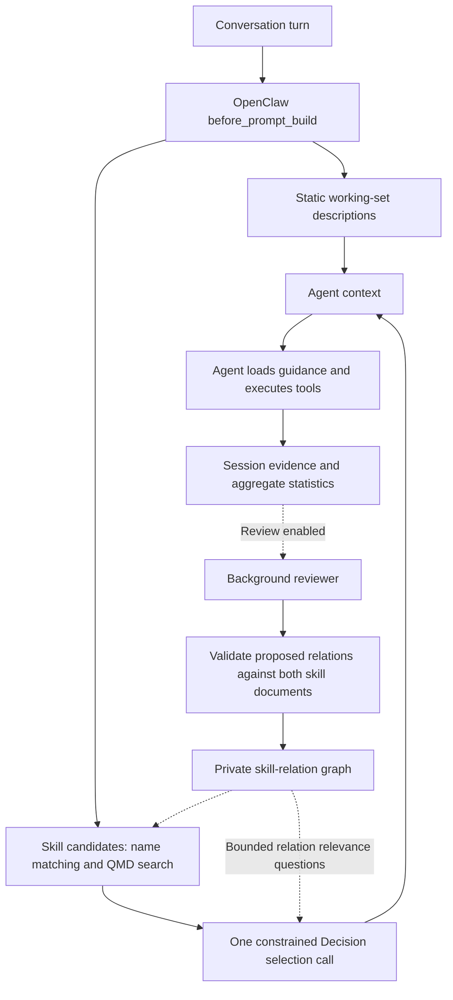

# Skill Harness

[](https://github.com/openclaw/openclaw)
[](https://opensource.org/licenses/MIT)

Skill Harness helps OpenClaw agents find and load the workflows relevant to a request. It searches each agent's visible skill library, considers documented relationships between skills, and adds short descriptions to the prompt. The agent can then open the full instructions through `skill_view`.

Skills remain ordinary files. An optional background reviewer reads skill documents in light of completed turns and proposes changes to a private relation graph.

## Why this project exists

As a skill library grows, listing every skill in every prompt consumes context and makes it harder to find the right workflow. Short descriptions also leave out details that matter for selection: applicability, prerequisites, operating steps, and failure conditions often appear only in the full skill document.

Some workflows also depend on context from another skill. A graph can make that connection discoverable while keeping the specific reason and direction available for inspection.

Three design choices keep the prompt focused.

- **On-demand discovery.** Search skill metadata, bodies, and reference files before selecting a bounded set for the current task.
- **Progressive loading.** Include descriptions and relevant relation hints in the prompt. Load full documents only when the agent needs them.
- **Evidence-based review.** Require exact evidence from both endpoint skills before accepting a proposed addition, correction, or deletion in the graph.

For example, a request to diagnose a deployment readiness failure can surface an operations skill through a troubleshooting procedure in its reference files. The agent sees the skill description and any relevant graph hints, then calls `skill_view` to read the procedure.

## Research context

These papers provide context for the design choices and related directions. The table distinguishes the research ideas from the behavior implemented here; the papers' benchmark results are not measurements of this plugin.

| Paper                                                                                                                          | Research idea                                                                                                     | Relationship to Skill Harness                                                                                                                                                                                                                                   |
| ------------------------------------------------------------------------------------------------------------------------------ | ----------------------------------------------------------------------------------------------------------------- | --------------------------------------------------------------------------------------------------------------------------------------------------------------------------------------------------------------------------------------------------------------- |
| [SkillRouter: Skill Routing for LLM Agents at Scale](https://arxiv.org/abs/2603.22455)                                         | Skill bodies contain routing evidence that names and descriptions can miss; retrieve candidates before reranking. | Searches metadata, bodies, and references, then uses one constrained Decision selection call. Uses QMD and Jev rather than SkillRouter's trained retrieval/reranking models.                                                                                    |
| [SkillDAG: Self-Evolving Typed Skill Graphs for LLM Skill Selection at Scale](https://arxiv.org/abs/2606.03056)                | Typed directed relations add structure to skill selection, and execution can inform graph evolution.              | Uses a private relation graph with bounded candidate expansion when usable evidence exists. Optional Review maintains imported and Review-created relations using exact skill-content evidence; relations remain advisory, without hard dependency enforcement. |
| [Compositional Skill Routing for LLM Agents: Decompose, Retrieve, and Compose (SkillWeaver)](https://arxiv.org/abs/2606.18051) | Complex tasks can require decomposition, retrieval, and dependency-aware composition of multiple skills.          | Selects multiple relevant skills; task decomposition and executable DAG planning remain related work, outside the current routing pipeline.                                                                                                                     |
| [SkillOpt: Executive Strategy for Self-Evolving Agent Skills](https://arxiv.org/abs/2605.23904)                                | Bounded edits to external state can be checked before publication.                                                | In Skill Harness, the editable state is the relation graph. The parent validates evidence, identities and revisions before publishing changes. Skill-file optimization using scored rollouts remains a research direction.                                      |

## Architecture



| Component           | Role                                                                                                                   |
| ------------------- | ---------------------------------------------------------------------------------------------------------------------- |
| Skill catalog       | Resolves the invoking agent's visible skills and provides discovery/loading tools.                                     |
| QMD skill index     | Retrieves visible skills across metadata, bodies, and references.                                                      |
| Decision selector   | Evaluates the combined candidate pool against the conversation and configured relevance thresholds.                    |
| Prompt integration  | Adds a static working set and compact, advisory dynamic context through OpenClaw hooks.                                |
| Background reviewer | Inspects completed turns and skill documents and can propose graph changes.                                            |
| Runtime state       | Holds session evidence, statistics, Review receipts, the relation graph and managed skill indexes outside the package. |

### Before a reply

1. Add skill-discovery guidance and the configured static working-set descriptions. Automatic workspace/workshop additions can be controlled separately.
2. For eligible agents and chats, combine typo-aware skill name matching with QMD search over the configured conversation context.
3. Deduplicate the retrieved skills. If the graph has usable evidence, expand one bounded hop from the original matches. A nonempty pool gets at most one Decision evaluation with a question for each skill and each eligible relation.
4. Inject selected skill descriptions up to the configured limit. Include a relation hint only when its anchor skill was selected and the relation meets its own relevance threshold.
5. The agent loads a skill or one of its reference files through `skill_view`.

Recent conversation input is stripped of Skill Harness, Hindsight Memory and native Active Memory injection blocks before skill selection. This prevents previous recommendations or recalled memories from being treated as user requests. The cleanup applies to routing input copies; it does not rewrite the session transcript or the main model's history.

The dynamic context marks its contents as advisory and puts the selected descriptions in `<matched_skills>`. Skills are ordered by selector score, with UTF-16 name order as a stable tie-break. Each applicable relation appears under its selected anchor skill.

Runtime search or selection failures let the main agent continue with available static context. Failed selection does not inject an unchecked fallback list. Invalid configuration can still prevent the plugin from loading.

When OpenClaw supplies a native request admission ID, prompt rebuilds for that request share one selection attempt, including a failed or cancelled attempt, even if the run ID changes. A different admitted request gets its own turn even when its text or run ID matches an earlier request. Superseded requests cannot restart selection; a rebuild after finalization keeps available static guidance without selecting again. A session-scoped admission digest preserves the same turn identity across plugin reloads. Hosts that omit admission IDs fall back to run/text-based matching. Missing canonical session keys are resolved through the SDK's asynchronous lookup for the supplied session ID; a supplied key requires no lookup.

### After a completed turn

Review is disabled by default. When enabled, it schedules a background check of skill relations on every tenth qualifying turn in a session. A completed turn qualifies if Skill Harness recommended a skill or recorded a successful skill load. A turn with several skills counts once. Turns with neither leave the count unchanged. The reviewer starts with the skills from the turn that reached the interval and may find that the graph needs no change.

The Review execution module loads only when Review is enabled and the turn reaches the configured interval. After asynchronous loading and snapshot preparation, the plugin rechecks lifecycle cancellation, scheduler disposal, host hook validity, and the originating turn before queueing work. Pipeline events remain synchronous. QMD itself remains loaded on demand.

The reviewer can propose creating, updating, or deleting imported and Review-created relations. It works from bounded snapshots and must cite both endpoint skills. The parent checks the current identities, evidence and targeted revisions before publishing the graph changes and their operation history.

The reviewer works with staged snapshots in a temporary workspace. It receives read-only tools for inspecting files and visible skills. The parent owns the graph writer. [Skill relations](#skill-relations)

## Installation and setup

Use OpenClaw **2026.11.10**, Node.js **26.12.1 or later**, and the pnpm version declared in [package.json](package.json). The manifest specifies the minimum compatible Gateway and the package pins its peer dependency to this release. Development CI uses Node.js 26.

### 1. Build and install

```bash
git clone https://github.com/ani6439walc/openclaw-plugin-skill-harness.git
cd openclaw-plugin-skill-harness
pnpm install --frozen-lockfile
pnpm run build
openclaw plugins install --link .
```

The linked installation uses this checkout. Rebuild after changing source files. Direct `git:` installation is unsupported because the compiled `dist/` entry is not tracked and the Git installer does not perform this build.

### 2. Configure model services

Merge this entry into your existing `openclaw.json`:

```json5
{
  plugins: {
    entries: {
      "skill-harness": {
        enabled: false,
        hooks: { allowConversationAccess: true },
        config: {
          qmd: {
            embedding: { model: "bifrost/text-embedding-3-small" },
            expansion: { model: "bifrost/gpt-4o-mini" },
            jev: { model: "typesafe/jev-latest" },
          },
          decisionModel: { model: "typesafe/jev-latest" },
        },
      },
    },
  },
}
```

`qmd.embedding.model` and `qmd.expansion.model` are required. The two Jev endpoints are optional and independent: `qmd.jev` serves QMD search only; plugin `decisionModel` serves automatic candidate selection when no host Decision model is selected, and the existing manual relation importer. Each endpoint, when present, requires a nonempty `model`; `baseUrl` and `apiKey` are optional. The example's `bifrost` and `typesafe` providers must already exist in OpenClaw's provider configuration. `provider/model` resolves endpoints and credentials from the provider catalog; explicit fields, environment references, and supported SecretRef objects retain their existing resolution. `qmd.embedding.dimension` defaults to `1536`; set it to match your embedding model.

Automatic selection first checks the invoking agent's host `decisionModel` string, then `agents.defaults.decisionModel`, then the plugin's endpoint object above. An explicit empty or whitespace-only agent string suppresses the global default and permits the plugin route; an absent, null, or non-string agent value inherits a nonempty global string. A host-only setup may omit plugin `decisionModel`; a plugin-only setup needs no host Decision selection. Without either route, dynamic selection is skipped. Every host call carries the owning `agentId`, including when the model is inherited globally. Once the host route is selected, unavailable providers, timeouts, malformed answers, and errors skip dynamic context without trying the plugin endpoint or conversational model.

Skill and relation questions share one full batch per eligible turn. Empty pools make no evaluation call; hook rebuilds reuse the same turn's in-flight or terminal result. Neither route retries, splits batches, nor trims candidates to fit a provider. Full-batch preflight rejects more than 256 questions, 1 MiB of JSON, 20,000 nodes, or depth 32; a provider's smaller limits may return `unsupported-input`, which skips selection. `routing.timeoutMs` defaults to 5,000 ms; host evaluation uses at most 30,000 ms. Host requests use the public Decision V1 API without model or thinking overrides. Turn deadlines and plugin shutdown cancel selection; static context remains available.

Managed skill searches keep `rerank: false`; query expansion continues to use `qmd.expansion`. `qmd.jev` can supply QMD's search-strategy/HyDE assistance and native reranking configuration. Omitting it does **not** disable all QMD Jev behavior: native `TYPESAFE_API_KEY`, `TYPESAFE_BASE_URL`, and `TYPESAFE_DEFAULT_MODEL` environment sources and QMD's Jev expansion path remain available. Neither plugin nor host `decisionModel` is forwarded to QMD. Changing plugin `decisionModel` does not rotate QMD stores; changing `qmd.jev` drains active operations and reopens the same database without changing the embedding fingerprint. The strict manifest rejects unknown fields.

External plugins need `hooks.allowConversationAccess: true` to register conversation hooks, including automatic prompt routing and end-of-turn Review. Keep `hooks` beside `config`, not inside it. Prompt modification is allowed by default; an explicit `hooks.allowPromptModification: false` disables the prompt hook even with conversation access. The plugin does not grant itself these permissions. See [OpenClaw hook permissions](https://docs.openclaw.ai/plugins/hooks#permissions-and-scope).

#### Shared document embedding cache and Voyage

The bundled QMD runtime (`@wei840222/qmd` `2026.11.10`) uses configured remote models only, alongside BM25, document reads, Chinese segmentation, AST chunking, CLI, and MCP. Configure the required `qmd.embedding` and `qmd.expansion` fields above; `qmd.jev` is independent and optional. Missing remote configuration produces an explicit model-operation error without choosing a provider or uploading documents, while pure lexical QMD operations require no model. Install with `pnpm install --frozen-lockfile` to reproduce the pinned dependency.

Before manual index maintenance or changing embedding models or dimensions, stop all Gateway generations and other processes using those indexes, then take a complete offline backup of `dataRoot/qmd/skills/` (including SQLite WAL/SHM files, agent mappings, metadata, and leases) outside the repository and package. Copying a running WAL database file by file is not a consistent backup. Changing embedding models or dimensions requires rebuilding the affected indexes under an explicit maintenance window; ordinary refresh does not destructively rebuild incompatible vectors.

Set optional `qmd.embeddingCacheDir` to share document embeddings across skill stores, agents, and processes that use the same directory. Without it, QMD uses its in-memory cache. The plugin forwards the directory unchanged after trimming whitespace; it does not append agent or generation names. QMD expands `~`; relative paths use the process working directory, **not** `dataRoot`. Prefer an absolute path on persistent disk, or tmpfs such as `/dev/shm` when RAM usage and loss on reboot are acceptable.

The QMD cache retains successful document embeddings for up to two hours, bounded to 2,000 entries / 64 MiB of payload (SQLite adds overhead). Identity, credentials, and exact formatted input must match. It does not persist query embeddings or expansion results. Cache misses sharing a directory serialize while the remote request runs; waiting respects the request timeout. Cache failure falls back to ordinary embedding, so this is not a permanent exactly-once guarantee. Changing the directory reopens stores after active operations drain without changing index fingerprints or rebuilding vectors. Read-only discovery does not create the disk cache.

Skill-index mapping publication, lifetime leases, and discovery reads share a FIFO catalog queue within each plugin instance. The one-second cross-process file-lock deadline starts only after local queue admission. Maintenance with a zero-wait budget skips a busy queue or lock immediately. Failed work releases the queue, and shutdown stops new work and drains accepted operations before stores close and leases release. Debug diagnostics report only operation category, acquisition outcome, and queue/lock/hold durations; they omit skill names, conversations, and credentials. Independent plugin instances coordinate through the file lock and lease format.

For native Voyage embeddings, merge this complete model configuration into the plugin config, retaining your configured expansion and Jev providers:

```json5
{
  qmd: {
    embeddingCacheDir: "/dev/shm/skill-harness-qmd-embeddings",
    embedding: { model: "voyageai/voyage-4", dimension: 1024 },
    expansion: { model: "bifrost/gpt-4o-mini" },
    jev: { model: "typesafe/jev-latest" },
  },
  decisionModel: { model: "typesafe/jev-latest" },
}
```

`voyage/` and `voyageai/` resolve to the official endpoint and `VOYAGE_API_KEY` from the Gateway environment when explicit or configured provider values are absent. Set `dimension: 1024` explicitly: the plugin retains its `1536` default. QMD supplies Voyage's native `input_type` and `output_dimension` fields ([Voyage API reference](https://docs.voyageai.com/reference/embeddings-api)). A custom gateway must accept that native protocol; a provider prefix selects connection settings, not the HTTP protocol.

### 3. Choose the static working set

Before enabling, move any native static skill selections into the plugin's `skills.workingSet`, and move intentionally shared `skills.load.extraDirs` paths into `skills.sharedRoots`:

```json5
{
  skills: {
    workingSet: {
      defaults: ["safe-default"],
      agents: { main: ["agent-first"] },
    },
    sharedRoots: ["/absolute/path/to/shared-skills"],
    includeWorkspaceSkills: true,
    includeWorkshopSkills: true,
  },
}
```

This is a fragment inside `plugins.entries["skill-harness"].config`. Replace the example skill names and directory with your own, or omit these optional settings.

By default, startup empties native `agents.defaults.skills`, removes agent-specific native `skills` lists, and clears `skills.load.extraDirs` to avoid duplicate prompt inventories. `skills.suppressNativeSkillPrompt` and `skills.suppressNativeExtraDirs` independently disable these mutations when set to `false`; native lists are not an input to the plugin's working set.

Agent-specific working-set entries appear before shared defaults, followed by enabled workspace and workshop additions. Include flags affect automatic prompt additions; the agent can still discover or explicitly load visible skills through tools. Changing the effective source roots may select a different skill index during the normal refresh lifecycle.

### 4. Enable and verify

```bash
openclaw plugins enable skill-harness
openclaw gateway restart
openclaw gateway status --deep --require-rpc
openclaw plugins inspect skill-harness --runtime --json
openclaw plugins doctor
```

`plugins inspect --runtime` loads the plugin in the inspecting CLI process and reports local registration, configuration, and blocked-hook diagnostics; it does not inspect the running Gateway's loaded instance. `gateway status --deep --require-rpc` checks Gateway availability. Verify the deployed build separately through the intended agent's actual `skill_list`, `skill_view`, and `skill_search` tools, then send an eligible direct-chat request and check Gateway logs and the resulting routing context. Indexes are built and refreshed in the background, so a newly installed plugin may initially have no semantic search results. See [OpenClaw hook troubleshooting](https://docs.openclaw.ai/plugins/hooks#troubleshooting).

After rebuilding an existing linked installation, use `openclaw plugins reload skill-harness` to replace the plugin instance, then repeat those checks. Local build, test, and CLI inspection results establish local compatibility; they do not prove that a running Gateway loaded the changed build.

## Using Skill Harness

### Automatic routing

Continue using your agent normally. By default, dynamic routing applies to agent `main` in direct chats, uses recent conversation context, and injects up to **8 skills**.

Automatic skill routing requires at least `routing.minTriggerChars` characters in the trimmed current request (default `5`, positive integer). Length uses JavaScript UTF-16 code units; most Chinese characters count as one. The check runs before adding conversation history, so earlier messages cannot make a short current request pass. Short requests keep static working-set guidance and access to manual skill tools. A successful manual load in a nonblank short request counts toward Review at the end of that turn. Set `routing.minTriggerChars` to `1` to allow single-character requests; blank input remains excluded.

To change scope or limits, merge a routing fragment into the plugin configuration:

```json5
{
  routing: {
    minTriggerChars: 5,
    scope: { agents: ["main"], chatTypes: ["direct"] },
    queryMode: "recent",
    skills: { maxInjectedSkills: 8 },
  },
}
```

Set `routing.skills.maxInjectedSkills: 0` to skip automatic skill discovery, relation scoring and dynamic injection. Static working-set guidance and the three agent tools remain available.

### Agent tools

Agents can use these tools even when automatically selected guidance is insufficient:

All three tools return the same JSON payload as rendered text for direct calls and as structured results for Code Mode, including tool-reported errors.

| Tool           | Inputs and purpose                                                                                                                                                                                                                                                                                                                                                                                 |
| -------------- | -------------------------------------------------------------------------------------------------------------------------------------------------------------------------------------------------------------------------------------------------------------------------------------------------------------------------------------------------------------------------------------------------- |
| `skill_list`   | Lists visible skills. `offset` defaults to 0; `limit` defaults to 150, maximum 500. Optional `show_stats` and `show_related` default to false. Follow pagination for larger catalogs.                                                                                                                                                                                                              |
| `skill_search` | Requires `query`; hybrid-searches metadata, bodies and references. `limit` defaults to 20, maximum 100. `show_evidence` and `show_related` default to true (each skill includes up to 3 top-ranked `related_skills` plus `related_skills_total`; pass `show_related: false` to omit them, or use `skill_view` for all relations); `show_stats` defaults to false. Returns `skills`, without paths. |
| `skill_view`   | Requires `name`; loads the skill document. Optional `file_path` loads a relative support file under `references/`, `templates/`, `scripts/`, `assets/`, or `examples/`.                                                                                                                                                                                                                            |

Example tool arguments:

```json
{ "query": "diagnose a deployment readiness failure", "limit": 5 }
```

Pass those arguments to `skill_search`, then use a returned name in `skill_view`, for example `{ "name": "your-operations-skill" }`.

### Enable review

Merge this into the plugin configuration to enable background relation review.

```json5
{
  review: {
    enabled: true,
    // Optional: otherwise resolves from the session or agent model.
    model: "your-provider/your-review-model",
  },
}
```

Omit the example `model` to use the session or agent model. Set `review.triggers.relationHealthCheck.everyTurns` to change the interval (an integer from 1 to 1,000, default 10). For example, at the default interval a session with nine qualifying turns can have several turns without skills before the next recommendation or successful load makes the tenth. Runs are debounced and serialized in the background. Each session persists its count across restarts, initializing from identifiable completed skill-bearing turns when a persisted counter is absent without replaying past reviews. Background scheduling is best effort: a restart can discard a queued check, and transcript text alone cannot confirm a turn for the cadence.

The reviewer can use `ls`, `read`, `skill_list`, `skill_search` and `skill_view`. Each run may incur model costs. Only the parent can publish a validated batch of graph operations.

### Skill relations

A skill-relation graph can expose related skills through `skill_view` (all direct edges), `skill_search` (`show_related` defaults to `true`, capped at 3 top-ranked edges per skill with `related_skills_total`), or `skill_list` with `show_related: true`. All tool relation lists sort by relation type priority (`depends_on`, `composes_with`, `specializes`, `conflicts_with`, `similar_to`, `related`), then `review` provenance before `author-import`. Author relations can be imported initially and maintained by Review. Automatic candidate expansion and relation scoring are always active when usable graph evidence exists.

New graphs use stable skill identities, such as `github:owner/repository:skill-key`, with content fingerprints kept separately from identity. Standalone local collections receive a persistent `local:<UUID>` source ID. A private `skill-relations/sources.json` registry binds each source and skill key to its current root, name and relative `SKILL.md` path. Moving a registered source updates its binding; explicit rename mappings preserve the skill key. Known remote origins retain their source identity when installed locally. Unknown or ambiguous bindings contribute no relation hints, while ordinary skill discovery remains available. Local skills with the same name in independent collections keep distinct identities, and only the invoking agent's visible winning sources can provide relation endpoints.

Each imported relation records the content fingerprints of both endpoints. Relation hints are available only while both endpoints match that evidence; changing a node cannot refresh older relations' evidence. Back up the source registry with the graph.

When Review runs, relation inspection starts from the union of that turn's final recommended skills and successfully loaded skills, filtered to the current agent's visible winning sources. Recommendation is not counted as loading, adoption or execution. Up to four existing incident graph neighbors are prepared first, using a persisted rotation position. The reviewer then searches autonomously from the conversation and skill content, with at most four `skill_search` calls. Calling `skill_view` admits eligible full skill snapshots into this run’s evidence scope. Existing and discovered endpoints share a budget of eight distinct extra-skill attempts; failed captures also consume a slot, while repeated reads reuse the same snapshot. Each proposal must touch an original seed; extra skills never seed another hop. Unregistered valid skills inside an agent's known OpenClaw skill roots (workshop, workspace, agent, managed, shared, plugin, and bundled roots) are automatically registered in `sources.json` during full-registration refreshes and Review while preserving existing remote/local bindings; unregistered skills outside known roots are skipped without allocating identities. Automatic bootstrap requires either an existing valid registry or a fresh install without an existing stable-ID graph; if `sources.json` is missing alongside an existing stable-ID `graph.jsonl`, automatic registration fails closed and requires restoring the registry backup.

The parent stages full `SKILL.md` copies in the temporary Review workspace, including eligible skills requested through Review’s `skill_view`. The tool returns the same captured content, line numbers and stable identity used for validation. Support files can inform understanding but do not become formal relation evidence. Review reads do not count as skill adoption or usage. Files larger than 256 KiB are unavailable as evidence, and the complete snapshot is capped at 2 MiB. Search snippets, scores, co-recommendation and co-loading do not establish a relation. Review must cite exact line ranges and excerpts from both endpoint snapshots and explain the type, direction and reason. Clear content evidence is sufficient without an execution trial. Review prefers specific documented relation types (`depends_on`, `composes_with`, `specializes`, `conflicts_with`, `similar_to`) over generic `related`, treats `related` as a last resort, and upgrades overly broad existing `related` edges when both endpoints support a narrower predicate. `depends_on` still requires an explicit necessary condition rather than helpful composition. Updates must identify the old error (including an overly broad `related` label); deletion needs contradiction, duplication or supersession rather than low usage or missing search results. All six types remain advisory and have no confidence levels.

Each Review may propose up to eight create/update/delete changes, including changes to imported author relations. After closing tool admission and draining accepted work, the parent verifies the accumulated evidence scope, exact excerpts, current visible winners, source bindings, content fingerprints and the latest operation revision of each target pair. A target conflict rejects the entire relation batch; unrelated graph changes do not block it. Accepted changes preserve all existing JSONL bytes and append logical operations: `relate` for create, `unrelate` plus `relate` for update, and `unrelate` for delete. The graph lock covers validation and atomic replacement of the complete file, so the new operations publish together. Operation-level `review` metadata stores batch/event/agent IDs, time, rationale, evidence digests and the previous relation, preserving imported `sourceGraphDigest` on updates.

Ordinary incremental imports cannot overwrite reviewed pairs or resurrect Review deletions. The full ontology import CLI rejects a destination with Review history; complete replacement requires the explicit graph snapshot maintenance path and a backup. Review does not compact history or reset sessions/statistics. Schema-v9 Review receipts record the number of committed graph operations, the batch ID and the outcome.

Every triggered run with eligible relation seeds must return separate `relationReview.existing` and `relationReview.discovery` assessments: `changes-proposed`, `no-change`, or `not-applicable` where permitted. These assessments describe model-reported inspection and proposals, not committed changes or proof of improved outcomes. `relationPreparation` records readiness, fixed skip reasons and aggregate capture counts; `relationSearchCount` records search attempts. A discovery `no-change` assessment requires at least one nonempty search attempt; an unavailable search still counts as an attempt, not a successful lookup. Existing `not-applicable` is valid only when the admitted evidence scope contains no existing relations. The runtime-health report separates these observations from committed relation operations.

Rotation positions live in `review.json` and are capped at 256 seed groups. A stable seed group and neighbor list advance through successive batches; changing groups, catalog changes or cursor eviction can repeat earlier samples. Search is bounded exploration, not exhaustive coverage. Canceled runs with no committed work retain the no-record behavior.

To customize the XML injection threshold, set:

```json5
{
  routing: { skills: { related: { relevanceThreshold: 0.8 } } },
}
```

Expansion adds a bounded outgoing hop from the first eight original skill candidates: at most two new skills per seed and eight per turn, distributed round-robin. Expanded endpoints never seed a second hop.

Candidate expansion and relation relevance scoring both prioritize `depends_on`, `composes_with`, `specializes`, `conflicts_with`, `similar_to`, and `related` in that order. Unrecognized types rank last. Within a type, Review edges take priority over author imports and edges with unspecified sources. Ties are broken by locale comparison of the neighbor name, direction, then relation type. This ordering applies within each seed for expansion and within each candidate for scoring.

The same Decision call also scores whether each graph relation, its reason and both endpoint descriptions offer useful reference value for the current task, independently from skill relevance. This assesses reference value rather than whether a relation is a verified or unmet prerequisite. Relation assertions remain unverified reference data, not instructions. For each skill candidate, it considers at most two incoming/outgoing relations (16 questions total), distributed round-robin across candidates and preserving the original direction. Both endpoints must be visible, identity-matching winning skills with a nonempty reason. Graph lookup, expansion deduplication and self comparisons use NFKC-normalized, trimmed, lowercase identities while displayed names retain their original spelling. The other endpoint may be outside the candidate pool: its name and description are supplied as background, without creating a candidate or using an injection slot. Reasons are bounded to 500 Unicode code points and each endpoint description to 1,000.

The shared Decision state exposes `skill_candidates` with names, descriptions, discovery sources and `relation_ids`, plus `skill_relation_evidence` with stable question IDs such as `relation_0`, anchor, direction, endpoint descriptions and relation reasons. Questions point to these entries so candidate provenance and the scored relation are explicit. Background endpoints remain outside `skill_candidates` unless independently discovered.

Only relations scoring at least `routing.skills.related.relevanceThreshold` (default `0.8`, inclusive range `0`–`1`) are rendered as `<relation>` children inside the final injected anchor skill's XML. Each child preserves `from`, `to`, type and relation reason. Scores stay in optional session/event diagnostics. Relation scores never change skill scores, routing confidence or injection caps. A related endpoint is not automatically loaded, and the prompt does not claim that prerequisites or execution order have been verified. All six relation types remain advisory, including dependency/conflict labels.

Relation expansion and scoring have no enable switch. The threshold supports live configuration updates and applies consistently to injection diagnostics and XML rendering on subsequent turns. A threshold of `0` allows every scored relation whose anchor is selected. This is separate from the skill selection threshold and the importer’s relation-type classification thresholds. Missing or invalid graphs leave ordinary routing working without relation evidence. Importing a graph remains a separate step; see the [staged import procedure in AGENTS.md](AGENTS.md#advanced-relation-import-procedure).

## Configuration reference

The full accepted schema is in [`openclaw.plugin.json`](openclaw.plugin.json). Common settings below live inside the plugin's `config` object. Host `agents.*.decisionModel` strings are configured outside that object:

| Setting                                     | Default                       | Effect                                                                                                     |
| ------------------------------------------- | ----------------------------- | ---------------------------------------------------------------------------------------------------------- |
| `decisionModel`                             | omitted                       | TypeSafe endpoint for plugin selection and manual relation classification; no QMD inheritance.             |
| `qmd.jev`                                   | omitted                       | QMD-only endpoint; native QMD expansion/environment fallbacks still apply.                                 |
| `routing.scope.agents` / `chatTypes`        | `["main"]` / `["direct"]`     | Select eligible agents and chat types. Optional allowed/denied chat-ID lists further restrict scope.       |
| `routing.queryMode`                         | `"recent"`                    | Choose `message`, `recent`, or `full` query context; `routing.contextWindow` bounds recent history.        |
| `routing.skills.search.minCandidateScore`   | `0.6`                         | Minimum semantic score for a skill candidate.                                                              |
| `routing.skills.relevanceThreshold`         | `0.6`                         | Minimum Decision score for injecting a skill.                                                              |
| `routing.skills.related.relevanceThreshold` | `0.8`                         | Minimum relation reference-value score for XML hints; 0–1, live-updatable, selected anchor still required. |
| `routing.skills.maxInjectedSkills`          | `8`                           | Maximum injected skills. Zero skips automatic discovery and selection.                                     |
| `routing.timeoutMs`                         | `5000`                        | Selection budget; host Decision caps it at 30,000 ms.                                                      |
| `qmd.timeoutMs`                             | `15000`                       | QMD request budget. `routing.skills.search.timeoutMs` can override the routing search budget.              |
| `qmd.indexRefreshIntervalSeconds`           | `300`                         | Background source-check interval; zero disables recurring checks.                                          |
| `skills.search.collectionWeights`           | meta/body/references: `3/2/1` | Relative collection weights for skill search.                                                              |
| `review.enabled`                            | `false`                       | Enable automatic skill-relation review.                                                                    |
| `review.thinking` / `timeoutSeconds`        | `"medium"` / `300`            | Reviewer reasoning level and run budget.                                                                   |

## Runtime health and troubleshooting

Use the maintenance CLI for a private, report-only check of retrieval, injection, recorded skill use, Review outcomes, index health, retention, and disk growth.

In a source checkout, run `pnpm install --frozen-lockfile` and `pnpm run build` first. Installed packages include the Review schema used by the audit.

```bash
node scripts/runtime-health-audit.mjs --days 7 --output /tmp/skill-harness-runtime-health.json
```

The report separates cumulative statistics from daily and retained-session observations. Missing data is reported as unavailable. Recorded skill use is not a measure of task success, and the report does not prove that the Gateway loaded the plugin. See the [audit procedure](AGENTS.md#runtime-health-audit-procedure).

Runtime state lives separately from package files under `~/.openclaw/plugins/skill-harness/`: sessions, `stats.json`, `review.json`, managed `qmd/skills/` indexes, and optional `skill-relations/`. Keep runtime files and reports private.

| Symptom                             | Check                                                                                                                                                                                |
| ----------------------------------- | ------------------------------------------------------------------------------------------------------------------------------------------------------------------------------------ |
| Plugin fails to load                | Run `openclaw plugins doctor`; verify the build, required QMD settings, optional Decision endpoints, and strict manifest schema.                                                     |
| No dynamic context                  | Check enabled state, agent/chat scope, index readiness, endpoints, thresholds and limits. No eligible candidates or failed selection intentionally inject no dynamic context.        |
| Search is unavailable after install | Allow background indexing to complete. Check the embedding and expansion endpoints and inspect skill-index refresh diagnostics.                                                      |
| Review proposes no new edge         | Check that Review is enabled, a trigger fired, eligible seeds were captured, and both endpoint skill documents support the proposed relation. A completed review may find no change. |
| Relation graph stays unchanged      | Check preparation, both relation assessments and committed operations separately. A completed `nofinding` run can be healthy; see the verification steps below.                      |
| Duplicate skill inventories         | Check native prompt suppression and migrate static selections to `skills.workingSet`.                                                                                                |

Skill-index refresh warnings include a JSON diagnostic suffix with the index fingerprint, failure phase, a fixed reason code, whether an existing store remains searchable, consecutive failures, retry delay, and a redacted error diagnostic (`errorName`, string `errorCode`, truncated `errorMessage`). A recovery message records the previous failure count when a later refresh and embedding check succeed. These fields survive the host's single-string logger contract. Credential assignments and `sk-` tokens are redacted; stacks, causes, raw provider bodies, queries, and credentials are excluded. Unknown failures use `operation-failed`. A refresh warning alone does not mean searches are unavailable.

Inventory failure diagnostics identify the root category, operation phase and fixed error classification. Private paths and source content are excluded.

The plugin keeps the turn open through provider fallback attempts and finalizes it when OpenClaw publishes the settled run outcome. Statistics and Review cadence use that outcome. Finalization taking 25 seconds emits one slow warning with its current phase (finalization, inventory, statistics, or Review preparation). If the work finishes after the warning, a completion message records elapsed time and outcome. The timer only reports progress.

### Verify relation Review after an upgrade

A healthy Gateway and successful ordinary skill tools do not prove that the isolated reviewer can use its tools or publish a result. After confirming the running plugin is active, inspect a completed, in-scope turn that triggered Review and recommended or successfully loaded a visible skill with a registered source. A skill can be searchable and readable without being registered for relation evidence.

Read the following observations together in the private Review log or runtime-health report:

| Observation                              | Meaning                                                                                                                                        |
| ---------------------------------------- | ---------------------------------------------------------------------------------------------------------------------------------------------- |
| `relationPreparation.status: ready`      | The parent captured eligible seed evidence. Counts describe prepared material, not proven model attention.                                     |
| `relationPreparation.status: skipped`    | Check the recorded reason, such as no eligible seeds or an unavailable source registry. This does not establish that relation inspection ran.  |
| `relationSearchCount > 0`                | The reviewer attempted a bounded search. It does not prove the search succeeded or supplied a new endpoint.                                    |
| Both assessments report `no-change`      | The reviewer reported no justified relation change; a valid completed `nofinding` run leaves the graph unchanged.                              |
| An assessment reports `changes-proposed` | Check publication receipts and committed findings before claiming a graph change. Validation or concurrency checks may still reject proposals. |

Use committed relation counts and batch receipts to report graph changes. A completed no-change run verifies that path only. Positive graph publication and improved task outcomes each require their own evidence. [Runtime-health procedure](AGENTS.md#verify-a-completed-relation-review)

## Contributing

Implementation contracts, source navigation, migrations, and development checks are maintained in [AGENTS.md](AGENTS.md). Manual maintenance and audit procedures also live there; their Node.js CLIs are under `scripts/`. Automatic routing and Review do not load these procedures.

## License

MIT.

### Package and isolated loader validation

`pnpm run build` removes stale `dist/` files before compilation. The published tarball includes runtime output, this README, the maintenance guide and four maintenance CLIs, excluding source maps and test helpers. It declares no bundled skill root. Inspect the actual `pnpm pack` tarball and its installed dependency closure; a source-tree build alone does not prove package contents.

For a reproducible loader comparison, extract and independently install baseline and candidate tarballs in temporary directories. Use the same OpenClaw and Node versions, then run:

```sh
node .github/scripts/measure-plugin-loader.mjs /path/to/openclaw/openclaw.mjs /tmp/baseline/package /tmp/candidate/package /path/to/private/results
```

The script alternates five timed fresh processes per build and runs a separate capacity process per build, calls the real `plugins inspect --runtime` loader in isolated profiles with fixed empty workspaces and mock endpoint configuration, and records loader time, total CLI time, and captured package/file/logical-byte counts. It does not clear OS caches or connect to a live Gateway. Keep machine-specific results private. A lower measured loader median supports a plugin loading improvement; it does not establish an improvement in every Gateway startup phase, and timing is not a CI threshold.

Record end-to-end Gateway readiness separately, with the same start and end boundaries; loader inspection, TCP binding, HTTP startup logging, and full readiness measure different work. Do not report overall startup optimization as complete from a loader result alone.

For lifecycle acceptance, check the final build's timer/disposal regressions and use the public `openclaw plugins reload skill-harness --wait --json` operation during an idle maintenance window. Verify retirement completed, old index leases were released after store closure, and the replacement instance serves actual Gateway tools. Report which resource counts the host exposes: a successful reload or absence of warnings alone does not prove zero remaining plugin timers. Keep active-work cancellation and disposal checks separate from ordinary chat completion and Review.
